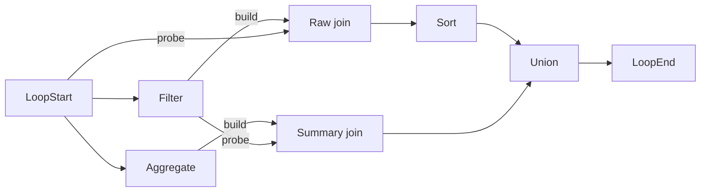

# A native workflow whose cheapest plan changes

This is a deliberately selected planning-correctness case, not a representative
application or a runtime benchmark. It closes a gap in the six native enrichment
workflows: their unique optimum stayed the same under both cost profiles.

## Result

| Plan | Regions | Stored edges | Aggregation-heavy cost | Join-heavy cost |
|---|---:|---:|---:|---:|
| A | 6 | 8 | **13** | 34 |
| B | 7 | 9 | 14 | **28** |

Costs are unitless estimates: sum of the largest operator estimate in each region.
Aggregation-heavy assigns 8 to each local/global aggregate stage; join-heavy assigns
8 to each build/probe join stage. All other original operators cost 1, and Y's
macro costs 0. These are the same profiles as the previous native comparison.

Plan A has fewer regions. Plan B puts the raw join's build stage and the summary
join's probe stage in the same region with Filter. Thus B has three regions
containing expensive join stages instead of four. The extra cut is worthwhile
under join-heavy costs, even though B has one more region overall.

Both X and Y choose A for aggregation-heavy costs and B for join-heavy costs,
with pruning on. There is no tie: independent full enumeration checks all
512 assignments per profile, finds 160 feasible plans, and finds one optimum.
Three repeated X/Y pairs per profile give 12 exported selections. The Scala
characterization also checks both planners with pruning off and cross-evaluates
each chosen plan under the other profile.

## Workflow

CSV -> LoopStart -> six native body operators -> LoopEnd -> output Sort.
The body has Filter, Aggregate, two Hash Joins, Sort and Union. Strict compilation
produces 13 physical operators and 15 edges in the complete workflow. Both joins
use `file` as their key; Aggregate sums `value` by file and names its result `value`,
so the two join outputs have the same schema for Union.



The four compiler-required cuts remain unchanged: the two build-to-probe links,
Aggregate's global output to the summary join, and Sort to Union. Only the two
external loop-boundary cuts are added by the existing research harness.

Both plans additionally store LoopStart -> raw-join probe. A also stores Filter
-> summary-join probe. B instead stores LoopStart -> Filter and summary-join probe
-> Union. The complete edge-index manifests and region lists are in the saved run.

## Reproduce

From the `codex/xy-planning-pilot` research checkout:

```powershell
powershell -NoProfile -ExecutionPolicy Bypass -File experiment/xy-planning/run-cost-choice.ps1
```

The runner pins HEAD and source hashes, runs `NativeCostChoiceXYSpec`, strictly
compiles the graph, exports both profiles and runs `check-cost-choice.py` against
the independent union-find/Kahn oracle. Output is under
`target/xy-planning-cost-choice/<timestamp>`. Timings in the common CSV format are
diagnostic only: this short correctness run has no warm-ups or timing-winner claim.

Verified run: `20261105-200947`, revision `b29f5260bc8c182915074d8860e281a38063963c`.
Two Scala tests, three existing oracle tests and seven corrupted-copy checks pass.
Scoped scalafmt/scalafix checks pass. Production code, main, prototype and the paper
were not edited. Main's ordinary loop scheduler still forces materialization;
this harness directly calls the planner and does not execute the workflow.

## Selection and limits

A symbolic scout modeled the native expansions before compiling the selected case.
There was no strict ranking reversal in the enumerated A/J-only recipes up to five
operators (4 + 38 + 452 + 7366 recipes), nor A/J/Union recipes containing all three
types up to five operators (16 + 458 + 13322). A six-operator A/J search was stopped
before completion. These are limited families, not a proof of global minimality.

A bounded random scout (seed 1105) adding Filter and Sort found a candidate at
zero-based trial 329. Removing two intermediate nodes and one redundant link
retained the reversal. A unary Union became the native Filter in the compiled case.
All reported costs and cuts were subsequently checked on the actual compiled
graph, independently of the scout. The saved study includes the scouting scripts
and candidates. This small selected graph establishes that the planner responds
correctly when costs change; it does not establish typical speedups or estimate
accuracy. No manuscript claim was added.
